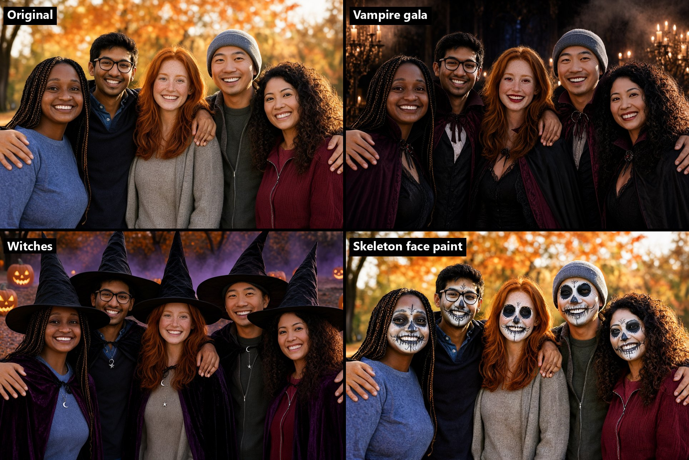
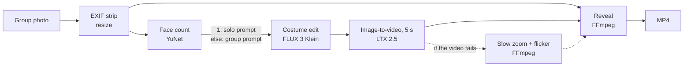

# 🎃 Halloween Switch

Upload a group photo, pick a costume, get a short **before → flash → after** video ready to share: the original photo, a white flash with a whoosh, then the same people in Halloween costumes, animated. The costume edit runs on [FLUX 3 Image Klein](https://huggingface.co/black-forest-labs/flux-3-image-klein), the animation on [LTX 2.5](https://huggingface.co/Lightricks/LTX-2.5), both through ComfyUI; FFmpeg assembles the reveal.



https://github.com/user-attachments/assets/487a70aa-0e95-4bf2-89b8-23fb39e423ba

Videos: [Vampire gala](examples/reveal_vampire.mp4) · [Witches](examples/reveal_witch.mp4) · [Skeleton face paint](examples/reveal_skeleton.mp4). All the people shown are AI-generated, see [examples/](examples/).

## How it works



1. **Edit** ([workflows/edit.json](workflows/edit.json)). Klein receives the photo as a reference and a prompt written as the caption of the target picture. Each preset keeps every person's skin tone, face, expression and pose, and carries the effect through costume, makeup and lighting, so that everyone stays recognizable. A face count selects a solo or group prompt to [prevent clones in selfies](#preventing-clones-in-selfies).
2. **Animation** ([workflows/i2v.json](workflows/i2v.json)). LTX 2.5 animates the edited image in two passes, a latent at half resolution then a ×2 latent upscale, 5 s at 24 fps. The prompt asks for a static camera and a frozen portrait, and moves only the setting: candle flames, fog, leaves.
3. **Reveal** ([pipeline/reveal.py](pipeline/reveal.py)). 1.5 s of the original photo, a white flash, then up to 4 s of the clip, with a synthesized whoosh and low thump on the cut. The frame follows the photo's aspect ratio, clamped between 4:5 and 16:9; the photo is never cropped, and margins, if any, get a blurred background. If the animation fails, the app falls back to a slow zoom on the still image, so it always returns a video.

The app talks to ComfyUI over its HTTP API ([pipeline/comfy_client.py](pipeline/comfy_client.py)), with a timeout at every step. The same code drives a local ComfyUI or [Comfy Cloud](https://cloud.comfy.org).

| Preset              | Look                                                                | Motion                               |
| ------------------- | ------------------------------------------------------------------- | ------------------------------------ |
| Vampire gala        | Victorian capes, red irises, subtle fangs, candlelit gothic hall    | candle flames, fog, capes in a draft |
| Witches             | pointed hats, velvet cloaks, moon jewelry, jack-o'-lanterns at dusk | pumpkin light, purple mist           |
| Skeleton face paint | Day of the Dead face paint that follows each face, orange dusk      | flickering light, drifting leaves    |

Prompts live in [pipeline/presets.py](pipeline/presets.py).

## Requirements

- Python 3.11+ and [FFmpeg](https://ffmpeg.org/download.html) on `PATH`.
- A ComfyUI server, either:
  - **Comfy Cloud**: an account with an active subscription and an API key; the models are already there;
  - **local [ComfyUI](https://github.com/comfyanonymous/ComfyUI)**, recent enough to run FLUX 3 Image Klein and LTX 2.5, with the models below. The 22B video model needs a large GPU (24 GB of VRAM or more).

## Install

```bash
git clone https://github.com/ylamidon/halloween-switch.git
cd halloween-switch
python -m venv .venv
source .venv/bin/activate        # Windows: .venv\Scripts\activate
pip install -e .
```

### Models (local ComfyUI only)

Put each file in the given folder under `ComfyUI/models/`, with the exact file name the workflows expect.

| File expected by the workflows                                     | Folder                   | Download                                                                                                                                                                                   |
| ------------------------------------------------------------------ | ------------------------ | ------------------------------------------------------------------------------------------------------------------------------------------------------------------------------------------ |
| `flux3-image-klein-base-int8-convrot.safetensors`                  | `diffusion_models/`      | [black-forest-labs/flux-3-image-klein-comfy](https://huggingface.co/black-forest-labs/flux-3-image-klein-comfy/blob/main/diffusion_models/flux3-image-klein-base-int8-convrot.safetensors) |
| `qwen3vl_4b_int8_convrot.safetensors`                              | `text_encoders/`         | [black-forest-labs/flux-3-image-klein-comfy](https://huggingface.co/black-forest-labs/flux-3-image-klein-comfy/blob/main/text_encoders/qwen3vl_4b_int8_convrot.safetensors)                |
| `flux2-vae.safetensors`                                            | `vae/`                   | [black-forest-labs/flux-3-image-klein-comfy](https://huggingface.co/black-forest-labs/flux-3-image-klein-comfy/blob/main/vae/flux2-vae.safetensors)                                        |
| `ltx-2.5-22b-distilled-transformer-comfy-int8-convrot.safetensors` | `diffusion_models/`      | [Lightricks/LTX-2.5](https://huggingface.co/Lightricks/LTX-2.5/blob/main/diffusion_models/ltx-2.5-22b-distilled-transformer-comfy-int8-convrot.safetensors)                                |
| `gemma4-12b-with-proj-ltx-2.5-comfy-int8-convrot.safetensors`      | `text_encoders/`         | [Lightricks/LTX-2.5](https://huggingface.co/Lightricks/LTX-2.5/blob/main/text_encoders/gemma4-12b-with-proj-ltx-2.5-comfy-int8-convrot.safetensors)                                        |
| `ltx-2.5-video-vae-bf16.safetensors`                               | `vae/`                   | [Lightricks/LTX-2.5](https://huggingface.co/Lightricks/LTX-2.5/blob/main/vae/ltx-2.5-video-vae-bf16.safetensors)                                                                           |
| `ltx-2.5-audio-vae-bf16.safetensors`                               | `vae/`                   | [Lightricks/LTX-2.5](https://huggingface.co/Lightricks/LTX-2.5/blob/main/vae/ltx-2.5-audio-vae-bf16.safetensors)                                                                           |
| `ltx-2.5-latent-spatial-upscaler-x2-bf16-1.0.safetensors`          | `latent_upscale_models/` | [Lightricks/LTX-2.5](https://huggingface.co/Lightricks/LTX-2.5/blob/main/latent_upscale_models/ltx-2.5-latent-spatial-upscaler-x2-bf16-1.0.safetensors)                                    |

<div style="border-left: 4px solid #cf222e; padding: 0.5em 1em; background-color: rgba(207, 34, 46, 0.1);">

Downloading the models means accepting their licenses: the FLUX Kommunity License and the LTX-2.x Community License, which limit commercial use. The LTX license requires you to disclose that outputs are AI-generated; the FLUX license requires it to the extent applicable law does. Both Hugging Face repositories are gated: accept the license on each repository page, then download while signed in (browser, or `hf auth login` before `hf download`). See [THIRD_PARTY_NOTICES.md](THIRD_PARTY_NOTICES.md).

</div>

## Run

**Run all commands below from the repo root with the `.venv` created in [Install](#install) activated.** If you open a new terminal, activate it again with `source .venv/bin/activate` (macOS/Linux) or `.\.venv\Scripts\Activate.ps1` (Windows PowerShell).

Choose one of the modes below. Once the app starts, open the URL Gradio prints, upload a photo, pick a costume and click **Switch!**. The queue runs one job at a time and shows progress per step: edit, animation, reveal. A job takes a few minutes, most of it in the animation.

### Local ComfyUI

Start your ComfyUI server at `http://127.0.0.1:8188`. If you previously configured Comfy Cloud, update your `.env` to use the local URL and leave the API key empty:

```dotenv
COMFY_URL=http://127.0.0.1:8188
COMFY_API_KEY=
```

Also remove or update any `COMFY_URL` and `COMFY_API_KEY` variables set in your terminal environment, since they override `.env`. Then run:

```bash
python app.py
```

### Comfy Cloud

Copy [.env.example](.env.example) to `.env` at the repo root and fill in your API key:

```dotenv
COMFY_URL=https://cloud.comfy.org
COMFY_API_KEY=your-api-key
```

Then run:

```bash
python app.py
```

### Mock mode

Try the app without ComfyUI or credits. This mode produces a tinted still image and a still-image reveal.

```bash
python app.py --mock
```

### Configuration

| Variable        | Default                 | Role                                                                                                                                                                                                             |
| --------------- | ----------------------- | ---------------------------------------------------------------------------------------------------------------------------------------------------------------------------------------------------------------- |
| `COMFY_URL`     | `http://127.0.0.1:8188` | ComfyUI server URL: `http://127.0.0.1:8188` for local ComfyUI, or `https://cloud.comfy.org` for Comfy Cloud.                                                                                                     |
| `COMFY_API_KEY` | Unset                   | Required for Comfy Cloud; leave empty for local ComfyUI. A non-empty key makes the client use the Cloud API behavior.                                                                                            |
| `COMFY_DIR`     | Unset                   | Path to the local ComfyUI folder, accessible from the app, e.g. `C:/tools/ComfyUI`. Enables cleanup of this job's files in its `input/` and `output/` folders; ignored in Cloud mode.                            |
| `APP_AUTH`      | Unset                   | Enables a login with `user:password` (split at the first `:`), both non-empty; a malformed value stops the launch. Required on Hugging Face Spaces and Railway unless running with `--mock`; optional elsewhere. |

Set these variables in your terminal environment or in a `.env` file at the repo root: copy [.env.example](.env.example) to `.env`, which git ignores. Values are read in this order: **terminal environment → `.env` → default**. Restart the app after changing them.

### Docker / Railway

The [Dockerfile](Dockerfile) bundles FFmpeg and listens on `$PORT` (default 7860). Locally: `docker build -t halloween-switch .` then `docker run -p 7860:7860 -e COMFY_URL=https://cloud.comfy.org -e COMFY_API_KEY=... -e APP_AUTH=user:password halloween-switch`. On [Railway](https://railway.com), create a service from this GitHub repository: the Dockerfile is detected automatically. Set `COMFY_URL`, `COMFY_API_KEY` and `APP_AUTH` as service variables, then generate a public domain under **Settings → Networking**.

### Run individual steps

Each step also runs on its own from the command line, which is handy to test a preset or tune the reveal:

```bash
python -m pipeline.comfy_client edit photo.jpg --preset witch -o out/              # costume edit (uses credits on Comfy Cloud)
python -m pipeline.comfy_client i2v out/<edit>.png --preset witch -o out/          # animation
python -m pipeline.reveal photo.jpg out/<clip>.mp4 -o reveal.mp4 --hold 1.2         # reveal; an image instead of the clip gives the zoom fallback
```

Seeds are random by default and printed at the end of each job; pass `--seed` to replay one.

## Privacy

A group photo shows other people's faces, which is personal data. The app strips EXIF metadata (GPS, camera) before anything leaves your machine, deletes each job's intermediate files as soon as the video is ready, and deletes uploads and results after 30 minutes. With `COMFY_DIR` set, it also removes the files ComfyUI kept in `input/` and `output/`; on Comfy Cloud, file retention follows the service's policy.

<div style="border-left: 4px solid #9a6700; padding: 0.5em 1em; background-color: rgba(154, 103, 0, 0.1);">

Only process photos of people who have agreed to it, and say the result is AI-generated when you share it.

</div>

## Improvements

### Preventing clones in selfies

**The problem:** a costume change could turn a selfie into a photo of two people. The presets were originally written for groups: phrases such as "the same people" and "capes" made Klein add a clone of the person, even though the prompt explicitly asked to keep the "same number of people". In the Vampire selfie comparison, none of the three runs with the group prompt preserved a single person.

**The fix:** each preset now has a dedicated solo prompt as well as its group prompt. The solo version describes "the exact same person", uses singular costume wording, and explicitly asks for "exactly one person only" with no extra people, duplicates or clones. Before the edit, [YuNet](https://github.com/opencv/opencv_zoo/tree/main/models/face_detection_yunet) counts the detected faces through OpenCV ([pipeline/faces.py](pipeline/faces.py)): exactly one selects the solo prompt; every other count keeps the group prompt. The detector is bundled in [pipeline/models/](pipeline/models/), so this step runs locally and offline. A count of 0 also keeps the group prompt, since masks or faces turned away can hide people from the detector.

**The result:** switching to the singular prompt preserved one person in all three Vampire selfie runs in the October 29 comparison:

| Prompt used on the selfie | Runs preserving exactly one person |
| ------------------------- | ---------------------------------- |
| Original group prompt     | 0/3                                |
| Dedicated solo prompt     | 3/3                                |

This is a small comparison on the Vampire preset, not a guarantee across all photos or costumes.

## Known limitations

- **Camera drift.** Despite the "static camera" prompt, LTX often zooms in or out over the 5 s, and faces can lose their expression after a few seconds: on the Vampire example the smiles fade after about 2 s. The reveal caps the clip at 4 s, which hides part of it.
- **Invented people.** When LTX zooms out, it can fill the wider frame with people who were not in the photo; on one Witch run with three people, about eight extras appeared from 3 s on. Running the job again draws a new seed.
- **Edit misses.** Now and then Klein returns the photo almost unchanged for a given seed. Running the job again draws a new seed.
- Presets were tuned on photos of four to five adults; very large groups or tiny faces are untested.

## Contributing

This repository is a demo project created for the competition. Contributions and pull requests are not accepted.

## License

The code is under the [MIT license](LICENSE). The generative models are not part of this repository (only the 227 KB YuNet face detector, MIT, is bundled) and keep their own licenses, see [THIRD_PARTY_NOTICES.md](THIRD_PARTY_NOTICES.md).
